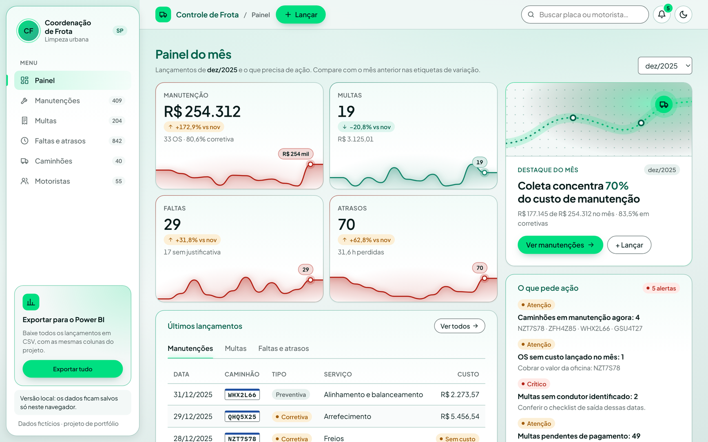
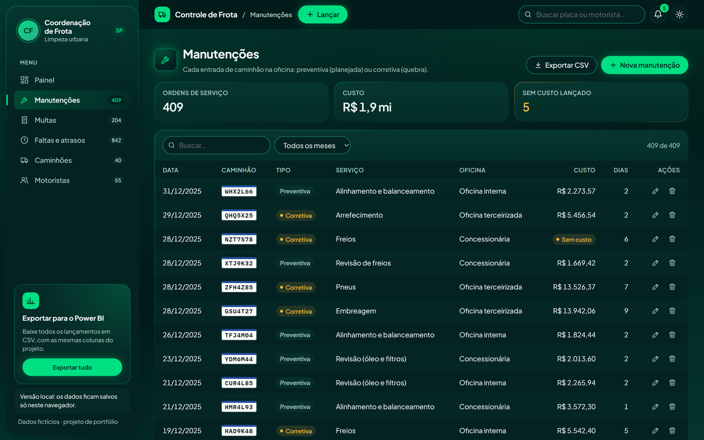
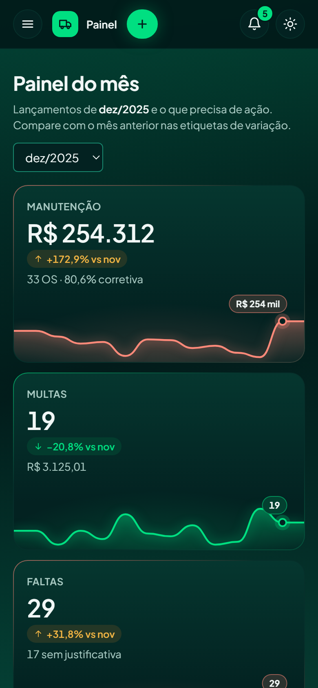
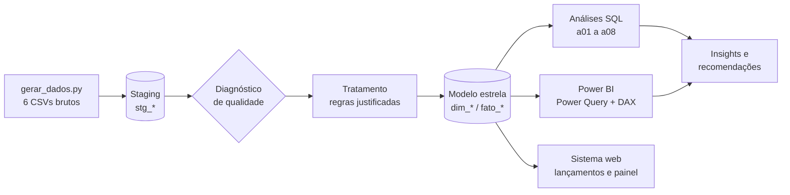

# 🚛 Gestão de Frota · Análise de Dados de ponta a ponta


Projeto de portfólio que simula a operação de uma **empresa de limpeza urbana em São Paulo**, com
40 caminhões (coleta, hidrojato e pipa) e 55 motoristas. Ele percorre o ciclo completo de um
analista de dados: **gerar e limpar os dados, modelar, analisar em SQL, montar o dashboard e
recomendar ações para a gestão**. Também inclui um **sistema web de lançamentos** com painel de
indicadores.

> ⚠️ **Todos os dados são fictícios**, gerados por script em Python. Nenhum dado real de empresa ou pessoa foi usado.


---

## ✨ Destaques

- **10 mil viagens, 409 manutenções, 204 multas e 842 faltas e atrasos** gerados com regras realistas: sazonalidade, quebras que aumentam com a idade do caminhão e erros propositais para limpar.
- **Limpeza com critério:** cada correção é justificada e registrada. Um outlier caro, mas possível, é mantido; um erro de digitação é corrigido.
- **8 análises em SQL** com CTE e funções de janela (`LAG`, `RANK`, `NTILE`, `SUM() OVER`).
- **5 insights para a gestão**, cada um com teste de robustez, recomendação e indicador de acompanhamento.
- **Sistema web** com lançamentos validados, KPIs com tendência de 12 meses, alertas do mês, tema claro e escuro e versão para celular.

## 📌 Sumário

- [Problema de negócio](#-problema-de-negócio)
- [O que o projeto entrega](#-o-que-o-projeto-entrega)
- [Sistema web](#️-sistema-web)
- [Como reproduzir](#️-como-reproduzir)
- [Metodologia](#-metodologia)
- [Power BI](#-power-bi)
- [Principais insights](#-principais-insights)
- [Estrutura do repositório](#-estrutura-do-repositório)
- [Sobre o desenvolvimento](#-sobre-o-desenvolvimento)
- [Próximos passos](#-próximos-passos)
- [Autor](#-autor)

---

## 🎯 Problema de negócio

A coordenação de frota de uma operação de limpeza urbana convive com quatro problemas:

1. **Custo de manutenção imprevisível:** quebras custam caro e tiram o caminhão da rua.
2. **Disponibilidade baixa:** caminhão parado é rota sem atendimento ou veículo reserva.
3. **Multas:** custo direto e risco de o motorista perder a CNH.
4. **Absenteísmo:** cada falta obriga a refazer a escala.

As informações existem, mas ficam espalhadas em planilhas, com erros e campos vazios, e sem uma
visão que ajude a **decidir o que fazer primeiro**.

**Perguntas que o projeto responde:** quanto custa operar a frota e quanto custa por km? Quais
caminhões concentram custo e tempo parado, e a idade pesa? A disponibilidade está na meta? Quais
motoristas concentram multas e faltas? Qual é o consumo de diesel esperado por tipo de caminhão?

## 📦 O que o projeto entrega

| Etapa | Ferramenta | Entrega |
|---|---|---|
| **Dados** | Python (Pandas, NumPy, Faker) | 6 tabelas fictícias e reproduzíveis (seed fixa), com sazonalidade e erros propositais |
| **Modelagem e limpeza** | SQL (SQLite) | Esquema estrela com camada de staging, chaves e restrições, diagnóstico de qualidade e regras de limpeza justificadas |
| **Análise** | SQL | 8 consultas comentadas, cada uma partindo de uma pergunta de negócio |
| **Dashboard** | Power BI (Power Query + DAX) | Guia completo com o código M e ~35 medidas DAX, validadas contra o SQL |
| **Sistema** | HTML, CSS e JavaScript | Lançamentos, painel de indicadores, alertas e exportação em CSV para o Power BI |
| **Negócio** | — | 5 insights com recomendação e indicador de acompanhamento |

## 🖥️ Sistema web

Um sistema de lançamentos para o dia a dia da coordenação. O que é lançado aparece na hora no painel.

<table>
  <tr>
    <td width="50%"></td>
    <td width="50%"></td>
  </tr>
  <tr>
    <td align="center"><sub>Painel do mês · tema claro</sub></td>
    <td align="center"><sub>Lançamentos de manutenção · tema escuro</sub></td>
  </tr>
</table>

<p align="center"></p>

**Funcionalidades**

- **Lançamentos com validação:** manutenção, multa, falta e atraso. A placa segue o padrão Mercosul, e escolher a infração preenche gravidade, pontos e valor pela tabela do CTB.
- **Indicadores do mês** com a variação sobre o mês anterior e a curva dos últimos 12 meses. A cor muda conforme a tendência: coral quando piora, verde quando melhora.
- **"O que pede ação":** alertas como OS sem custo lançado, multa sem condutor identificado e motorista acima de 40 pontos em 12 meses.
- **Destaque do mês, anel da frota e últimos lançamentos** em abas.
- **Exportação em CSV** com as mesmas colunas do projeto, para levar ao Power BI.
- **Acessibilidade:** contraste WCAG AA medido nos dois temas, navegação por teclado e respeito a "reduzir movimento".

**Como abrir:** dê dois cliques em [`sistema/controle_de_frota_local.html`](sistema/controle_de_frota_local.html).
Ele abre no navegador, já com os dados fictícios de 2025, e guarda os lançamentos no próprio
navegador. Para voltar aos dados originais, acrescente `?restaurar` ao endereço, antes do `#`.

## ▶️ Como reproduzir

**Pré-requisitos:** Python 3.10 ou mais recente. Para o dashboard, o Power BI Desktop (gratuito, Windows).

```bash
# 1. Clonar o repositório
git clone https://github.com/gabrielroliveira98-cell/gestao-de-frota.git
cd gestao-de-frota

# 2. (Opcional) Criar um ambiente virtual
python -m venv .venv
.venv\Scripts\activate            # Windows  |  source .venv/bin/activate (Linux/Mac)

# 3. Instalar as dependências
pip install -r requirements.txt

# 4. Gerar os dados brutos (sempre os mesmos, por causa da seed 42)
python scripts/gerar_dados.py

# 5. Montar o banco SQLite, limpar e exportar os dados tratados
python scripts/carregar_banco.py

# 6. Rodar as análises SQL e ver o resultado no terminal
python scripts/executar_query.py --todas

# 7. (Opcional) Gerar de novo a versão local do sistema com os dados atualizados
python scripts/gerar_sistema_local.py
```

> Os passos 4 a 7 são opcionais para quem só quer explorar: os CSVs e o sistema já estão no repositório.

## 🔬 Metodologia



**1. Geração dos dados.** Doze meses de operação (2025) com regras que deixam os dados coerentes:
caminhão em manutenção não roda, motorista que faltou é substituído por um reserva, e multa só
existe em viagem que aconteceu. Há **sazonalidade** (hidrojato nas chuvas, pipa na estiagem,
coleta nas festas) e **problemas propositais**: nulos, duplicatas, outliers e textos inconsistentes.

**2. Qualidade e limpeza.** Primeiro **medir** ([`02_diagnostico_qualidade.sql`](queries/02_diagnostico_qualidade.sql)),
depois **tratar** ([`03_tratamento_dados.sql`](queries/03_tratamento_dados.sql)). A regra foi
corrigir só quando há evidência do valor certo. Cada alteração fica registrada na coluna `obs_tratamento`.

| Problema encontrado | Tratamento | Por quê |
|---|---|---|
| 25 viagens duplicadas | Removidas | Cópias idênticas |
| 8 registros de km com valor ~10x | Divididos por 10 | O maior valor plausível é 158 km/dia; os suspeitos começam em 431 |
| Preventiva de R$ 191 mil | Dividida por 100 | Preventivas custam no máximo ~R$ 4,7 mil (casas decimais erradas) |
| Corretivas de motor de R$ 78 mil a R$ 103 mil | **Mantidas** | Caras, mas possíveis: outlier não é sinônimo de erro |
| 5 OS sem custo | **Mantidas vazias** e sinalizadas | Inventar um valor esconderia o problema da gestão |
| Multas sem valor | Preenchidas pela gravidade | O valor é definido pelo CTB |
| Multas sem condutor | Membro "Não identificado" | Evita "(Em branco)" e expõe a falha de controle |
| Texto inconsistente (`CORRETIVA `) | Padronizado | `TRIM` e caixa |

**3. Modelagem.** Esquema estrela (constelação de fatos) com 3 dimensões (veículo, motorista e
calendário) e 4 fatos (viagem, manutenção, multa e ausência). Diagrama e explicação em
[`docs/modelo_de_dados.md`](docs/modelo_de_dados.md).

**4. Análise em SQL.** Oito consultas comentadas em [`queries/analises/`](queries/analises/):

| Arquivo | Pergunta de negócio | Técnicas |
|---|---|---|
| a01 | Custo de manutenção por veículo e tipo | `LEFT JOIN`, `SUM(CASE)`, `SUM() OVER ()` |
| a02 | Veículos mais tempo parados e disponibilidade | CTEs encadeadas, `RANK()` |
| a03 | Ranking de motoristas por multas (Pareto) | `DENSE_RANK()`, % acumulado com `ROWS UNBOUNDED PRECEDING` |
| a04 | Ranking de absenteísmo | JOIN com calendário por desigualdade, `NTILE(4)` |
| a05 | Evolução mensal de custos e variação % | `LAG()`, acumulado com `SUM() OVER (ORDER BY)` |
| a06 | Consumo de diesel por tipo e idade | Média ponderada × média simples, `MAX() OVER (PARTITION BY)` |
| a07 | Custo corretivo por faixa de idade | Participação % com funções de janela |
| a08 | Sazonalidade da operação | `AVG() OVER (PARTITION BY)`, índice sazonal |

## 📊 Power BI

O passo a passo completo está em [`docs/guia_power_bi.md`](docs/guia_power_bi.md): importação
parametrizada no Power Query (com o código M de cada tabela), relacionamentos, tabela calendário
em DAX, cerca de 35 medidas comentadas, layout de 3 páginas (Visão Geral, Manutenção e Custos,
Motoristas e Multas) e uma **tabela de validação**, com o valor que cada medida deve dar segundo o
SQL. O tema de cores está em [`dashboards/tema_gestao_frota.json`](dashboards/tema_gestao_frota.json).

> 🚧 O arquivo `.pbix` está em construção, seguindo esse guia. Enquanto isso, o
> [sistema web](#️-sistema-web) mostra os mesmos indicadores.

## 💡 Principais insights

Em 2025 a frota custou **R$ 4,2 milhões** (R$ 5,51 por km), com disponibilidade de **91,3%**, abaixo da meta de 92%.

| # | Achado | Recomendação |
|---|---|---|
| 1 | Caminhões de coleta com **mais de 10 anos custam 3,1x mais** em manutenção corretiva (R$ 59,6 mil contra R$ 19,1 mil por caminhão no ano). O resultado se mantém sem os outliers | Estudo de renovação, começando por 2 placas que somam 18% do custo de manutenção |
| 2 | **66% da manutenção é corretiva**, e **48%** dela acontece entre dezembro e março | "Operação Verão": preventiva reforçada em outubro e novembro |
| 3 | **3 caminhões** somam 18% dos dias parados. Resolvendo só eles, a disponibilidade iria a **92,4%** | Decidir entre reforma e substituição em 60 dias |
| 4 | **1 motorista concentra 15%** do valor das multas (5x a média por viagem), e **6,3%** das multas não têm condutor identificado | Ação individual, reciclagem do top 10 e checklist de saída |
| 5 | **25% dos motoristas concentram 53% das faltas**, e os atrasos sobem **48%** na época de chuvas | Acompanhamento com o RH e plano de chuvas com mais reservas |

**Um cuidado que fez diferença:** dezembro aparece com +62% no custo total sobre novembro. Ao
decompor, 41% da manutenção do mês vinha de **uma única troca de motor**. Sem ela, a alta cai para
27%, compatível com a sazonalidade do verão. Ou seja, não era tendência.

➡️ Análise completa, com testes de robustez, premissas e limitações: [`docs/insights.md`](docs/insights.md)

## 📁 Estrutura do repositório

```
gestao-de-frota/
├── data/
│   ├── raw/                      # CSVs brutos gerados (com problemas de qualidade propositais)
│   └── processed/                # CSVs tratados, no formato do modelo estrela
├── scripts/
│   ├── gerar_dados.py            # gera os 6 CSVs brutos
│   ├── carregar_banco.py         # monta o banco SQLite, limpa e exporta os dados tratados
│   ├── executar_query.py         # roda qualquer .sql e mostra o resultado no terminal
│   └── gerar_sistema_local.py    # gera a versão do sistema que abre direto no navegador
├── queries/
│   ├── 01_criar_tabelas.sql          # staging + modelo estrela (PK, FK, CHECK, índices)
│   ├── 02_diagnostico_qualidade.sql  # mede os problemas antes de limpar
│   ├── 03_tratamento_dados.sql       # regras de limpeza justificadas
│   └── analises/                     # a01 a a08: perguntas de negócio
├── sistema/
│   ├── controle_de_frota.html        # código-fonte do sistema web
│   └── controle_de_frota_local.html  # versão para abrir com dois cliques (com dados de exemplo)
├── dashboards/
│   └── tema_gestao_frota.json        # tema de cores do Power BI
├── docs/
│   ├── dicionario_de_dados.md
│   ├── modelo_de_dados.md            # diagrama do esquema estrela
│   ├── guia_power_bi.md              # passo a passo do dashboard
│   ├── insights.md                   # insights e recomendações completos
│   ├── img/                          # capturas de tela do sistema
│   └── linkedin/                     # imagens usadas na divulgação do projeto
├── requirements.txt
└── README.md
```

## 🤖 Sobre o desenvolvimento

Desenvolvi este projeto com apoio de IA (Claude, da Anthropic), que ajudou a escrever código,
revisar as análises e desenhar a interface. As escolhas do projeto foram minhas: o tema, que vem da
minha rotina com frota, as perguntas de negócio e a validação de cada decisão.

## 🚀 Próximos passos

- [ ] Concluir o dashboard em Power BI e publicar os prints e o PDF.
- [ ] **Custo total de propriedade:** comparar manter × trocar os caminhões antigos (payback).
- [ ] **Previsão de demanda** por tipo de caminhão, para dimensionar a frota reserva.
- [ ] **Migrar para PostgreSQL** e agendar a atualização dos dados.
- [ ] **Testes automatizados de qualidade** (`pytest`) que falhem se surgirem novos problemas nos dados.

## 👤 Autor

**Gabriel Rodrigues de Oliveira**
Coordenação de motoristas e indicadores de frota, em transição para a área de dados. Este projeto
reproduz, com dados fictícios, problemas que vejo na rotina operacional.

- GitHub: [@gabrielroliveira98-cell](https://github.com/gabrielroliveira98-cell)

---

<sub>Dados 100% fictícios, gerados para estudo e portfólio.</sub>
