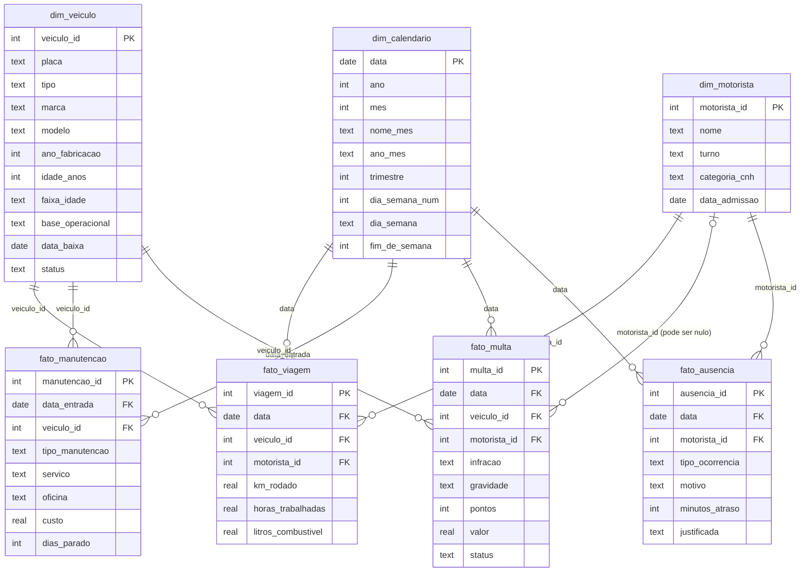

# Modelo de Dados: Esquema Estrela

## Visão geral

O modelo separa **o que é cadastro** (dimensões: *quem*, *o quê*, *quando*) do **que é evento**
(fatos: *o que aconteceu*, com números para somar). As tabelas fato nunca se ligam
diretamente entre si: elas conversam **através das dimensões que compartilham**.

Como há mais de uma tabela fato usando as mesmas dimensões, o nome técnico é
**constelação de fatos** (*galaxy schema*): várias estrelas que dividem as mesmas pontas.



> O GitHub desenha esse diagrama automaticamente (bloco `mermaid`).

## Granularidade das tabelas fato

**Granularidade** é a resposta para a pergunta: *o que representa uma linha?*
Definir isso antes de tudo evita somar coisas erradas.

| Tabela | Uma linha representa | Métricas (somáveis) |
|---|---|---|
| fato_viagem | um veículo operando em um dia com um motorista | km, horas, litros |
| fato_manutencao | uma entrada do veículo na oficina (ordem de serviço) | custo, dias parado |
| fato_multa | um auto de infração | valor, pontos |
| fato_ausencia | uma falta ou um atraso de um motorista em um dia | minutos de atraso, contagem |

## Relacionamentos

Todos os relacionamentos são **1 : N (um para muitos)**, saindo da dimensão para o fato:

| Dimensão (lado 1) | Fato (lado N) | Chave | Observação |
|---|---|---|---|
| dim_calendario | as 4 fatos | data | Permite filtrar tudo por mês/trimestre com um único filtro |
| dim_veiculo | viagem, manutenção, multa | veiculo_id | Ausência não tem veículo (é do motorista) |
| dim_motorista | viagem, multa, ausência | motorista_id | Em multa a chave **pode ser nula**: condutor não identificado |

**Por que não ligar `fato_multa` direto em `fato_viagem`?** Ligar fato com fato cria
relacionamentos N:N e ambiguidade de filtro no Power BI. Se eu quiser "multas por km rodado",
cruzo as duas pelo veículo e pelo mês, que são dimensões em comum.

## Por que esquema estrela (e não uma tabelona única)?

1. **Desempenho:** o Power BI (motor VertiPaq) é otimizado para estrela, e as dimensões pequenas filtram fatos grandes.
2. **Sem repetição:** a placa e o modelo ficam em um lugar só, não repetidos em 10 mil linhas.
3. **Filtros consistentes:** um único segmentador de "Tipo de veículo" filtra viagens, manutenções e multas ao mesmo tempo.
4. **DAX mais simples:** medidas como `SUM(fato_manutencao[custo])` funcionam com qualquer filtro de dimensão.

## Camadas do banco

```
CSV bruto ──► stg_*  (staging: cópia fiel, sem regras)
                │
                ▼  queries/03_tratamento_dados.sql
          dim_* / fato_*  (modelo estrela limpo, com PK, FK e CHECK)
                │
                ▼
     data/processed/*.csv  ──►  Power BI
```

A camada *staging* preserva o dado original. Assim qualquer regra de limpeza pode ser
revista e reaplicada sem perder informação.
